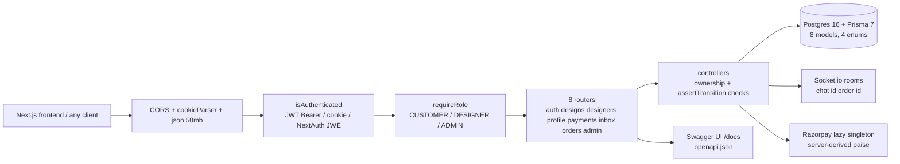

# StytchUp API — Express + Socket.io Marketplace Backend

I built the API for StytchUp, a marketplace for made-to-order and custom designer fashion. It handles auth with RBAC, a state-driven order lifecycle, Razorpay payments, realtime chat negotiation over Socket.io, and serves Swagger docs — all in plain Node.js with zero test dependencies.


## Key highlights

- One shared transition map (`src/lib/orderTransitions.js:4-12`) enforces the full lifecycle `PENDING → AWAITING_REQUIREMENTS → IN_PROGRESS → SHIPPED → COMPLETED` (+ `CANCELLED`/`REFUNDED`) across orders, payments, and admin cancel.
- Payments never trust the client: amounts are derived server-side in integer paise and signatures verified with HMAC-SHA256 `timingSafeEqual` (`src/controllers/paymentControllers.js:54,81`, `src/lib/paymentVerify.js:4-17`).
- Realtime rooms are participant-verified (`join_chat`, `join_order`) with `new_message` / `offer_created` / `offer_accepted` / `order_updated` on every lifecycle mutation (`src/lib/socket.js:35,47,72-76`).
- 32 documented endpoints (`GET /docs`, `GET /openapi.json`) over 8 routers; 31 `node:test` suites with zero deps, all passing.
- Dual-auth middleware accepts backend JWTs and NextAuth JWE sessions (`src/middleware/authMiddleware.js:16-69`), so the Next.js frontend works without a second user store.

## Architecture

Thin routes → thin controllers → Prisma → Postgres. Auth runs before everything; sockets emit after every mutation.



## Features

- **Auth:** register (always `CUSTOMER`), login (JWT 7d + httpOnly cookie), Google find-or-create sync, self-service customer ↔ designer switch (never `ADMIN`).
- **RBAC:** `requireRole()` guards designer writes and all 7 `/admin/*` ops endpoints (user roles, order cancel/refund, design visibility).
- **Catalog:** public `GET /designs`, designer `POST /designs/add` (paise); designer list + portfolio.
- **Payments:** `POST /payments/create-order` (`CATALOG`/`CHAT_OFFER`) → Razorpay order + `PENDING`; `POST /payments/verify` (HMAC) → `AWAITING_REQUIREMENTS`.
- **Chat/offers:** get-or-create 1:1 conversations, text or priced offers, participant-checked history.
- **Orders:** accept offer, submit measurements → `IN_PROGRESS`, ship (tracking required, designer) → `SHIPPED`, confirm receipt → `COMPLETED`; buyer and designer queues.
- **Docs/ops:** `GET /health`, `GET /docs`, `GET /openapi.json`; Docker `HEALTHCHECK` hits `/health`.

## Design decisions and trade-offs

1. **Single transition map over scattered checks:** one `TRANSITIONS` object + `assertTransition` is imported by orders, payments, and admin — illegal states are unrepresentable, at the cost of all lifecycle knowledge living in one file.
2. **Integer paise over floats:** money is `Math.round(rupees * 100)` everywhere (`src/lib/pricing.js`); no `0.1 + 0.2` class of bugs, at the cost of converting at every boundary.
3. **Server-derived amounts over client amounts:** `create-order` takes only `{ sourceId, type }` and prices from the DB (contract-tested on both sides). Costs one extra lookup per checkout.
4. **Lazy Razorpay singleton over fail-fast init:** `getRazorpay()` returns null without keys so the API boots and serves everything except payments — better for dev/CI, worse for surfacing misconfig (payment calls fail late).
5. **JWT + NextAuth-JWE compat over pure JWT:** the middleware verifies backend tokens first, then decrypts NextAuth sessions with an HKDF-derived key, so the Next.js frontend needs no user store of its own. Cost: two auth code paths to maintain.

## Quick start

```bash
npm ci
cp .env.example .env   # then fill in secrets (table below)
npx prisma generate
npx prisma db push
npm run dev            # node --watch src/index.js → http://localhost:4000
```

| Variable | Required | Purpose |
|---|---|---|
| `DATABASE_URL` | yes | Postgres connection string |
| `JWT_SECRET` | yes | Signs backend JWTs |
| `NEXTAUTH_SECRET` | yes | Must match frontend (JWE compat) |
| `RAZORPAY_KEY_ID` / `RAZORPAY_KEY_SECRET` | for payments | Order creation + HMAC verify |
| `PORT` | no (default `4000`) | API port |

Docker Compose (needs `../stytchup` sibling checkout, API + sockets `:4000`, web `:3000`, Postgres `:5432`):

```bash
cp .env.example .env   # set JWT_SECRET, NEXTAUTH_SECRET at minimum
docker compose up --build
```

> Note: `compose.yaml` still passes `VITE_*` build args but the frontend `main` branch is Next.js again (needs `NEXT_PUBLIC_*`). Override with `--build-arg` or update compose.

```bash
npm test    # 31 tests, verified passing (~0.5s, no DB)
npm start   # production: node src/index.js
```

## Project structure

```
prisma/schema.prisma  # 8 models (User, Profile, Address, Design, Order, Review, Conversation, Message) + Role/OrderStatus enums
src/index.js          # express app + socket bootstrap + /health + /docs mount
src/routes/           # 8 thin routers with @openapi annotations + middleware chain
src/controllers/      # handlers: ownership + assertTransition + prisma + emit
src/middleware/       # isAuthenticated (JWT/JWE), requireRole
src/lib/              # socket, razorpay (lazy), pricing, paymentVerify, orderTransitions, swagger
src/utils/            # signToken, NextAuth key derivation
tests/                # 31 node:test suites, zero deps
compose.yaml          # postgres + backend + frontend stack
Dockerfile            # 3-stage, non-root appuser, HEALTHCHECK /health
.github/workflows/   # ci.yml: test → OpenAPI check → docker builds
```

## Limitations and future work

- `prisma/migrations/` is declared but only `schema.prisma` exists — schema syncs via `db push`, no migration history.
- `Review` model has no endpoints yet (schema-only).
- Pruned backend leftovers with zero imports in `src/`: `bullmq`, `ioredis`, `stripe`, `next`, `next-auth`, `crypto` shim (`require('crypto')` resolves to the Node builtin).
- Admin listings use `take: 100` with no pagination; no rate limiting; `express.json` limit is 50mb for base64 images.
- Load numbers (p99, throughput) not measured yet — the next step is k6/autocannon against staging.

## Tech stack

Node 20, Express 5.1, Socket.io 4.8, Prisma 7 + Postgres 16, Razorpay 2.9, bcrypt + jsonwebtoken + jose, Swagger UI. Tests: built-in `node:test` only. Docker multi-stage, GitHub Actions.

Contact: built by **imad-ice** — [github.com/ima-d-ice](https://github.com/ima-d-ice) — imads8444@gmail.com. Frontend: [ima-d-ice/stytchup](https://github.com/ima-d-ice/stytchup).
